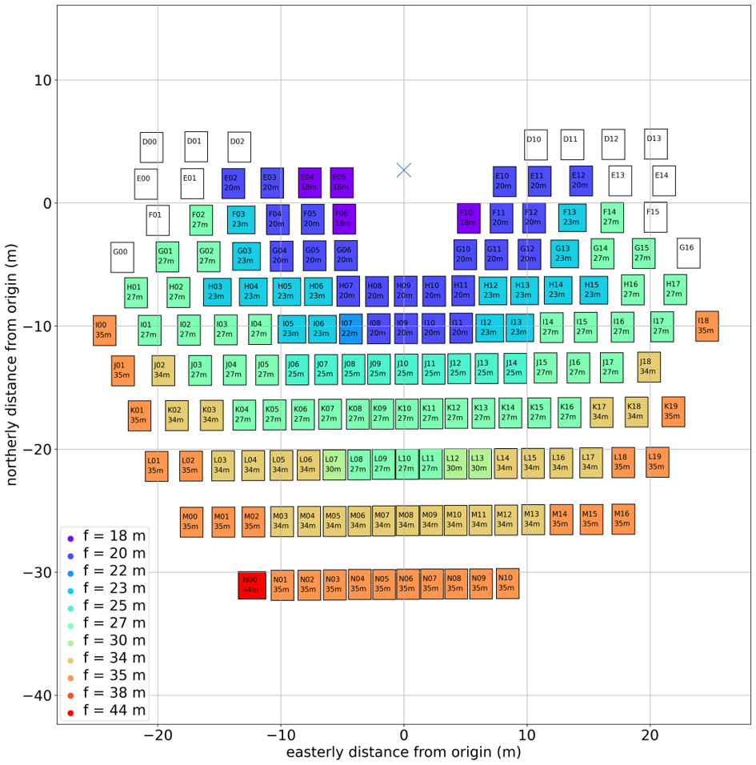
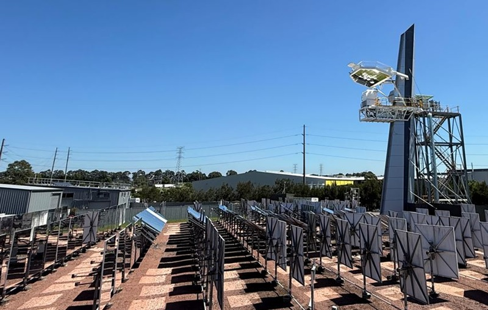
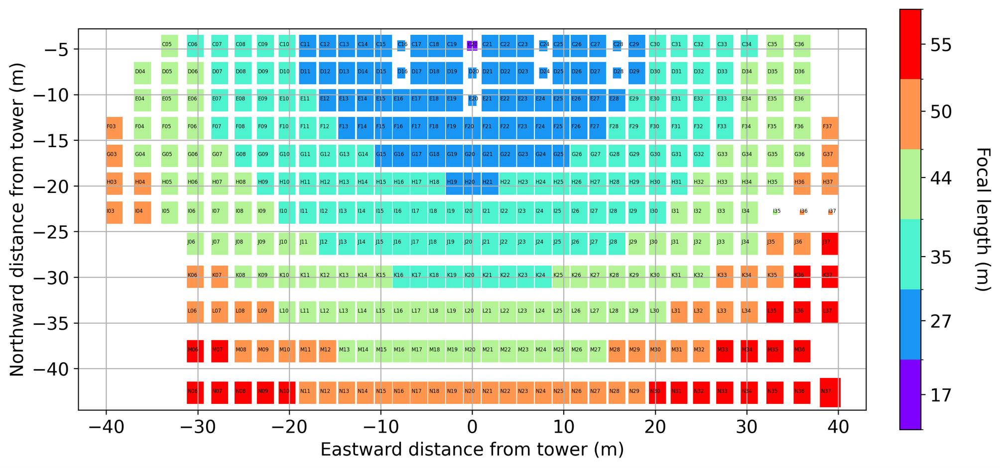
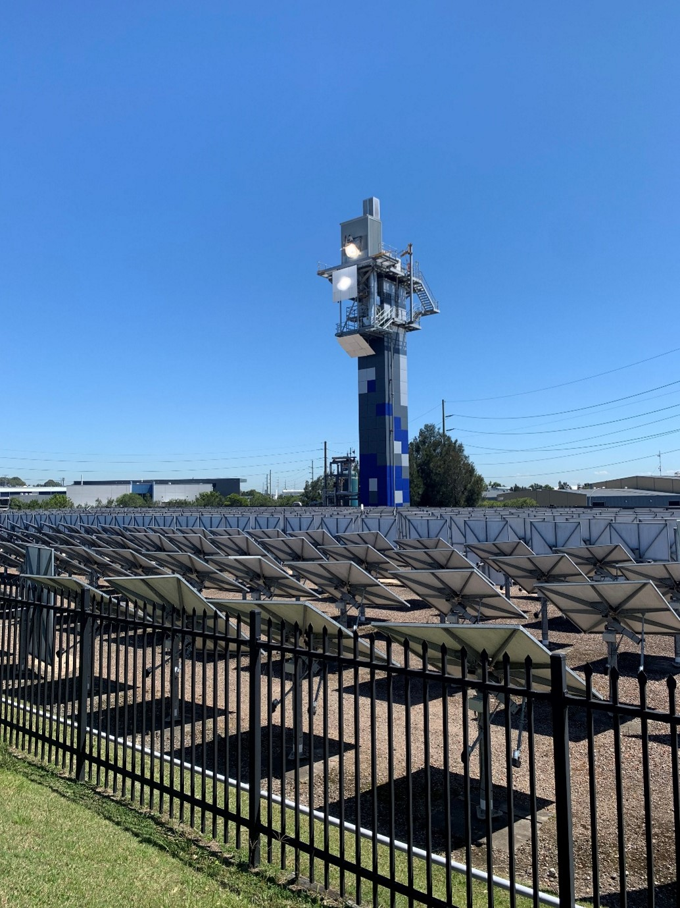

# Heliostat Surface Analysis

*Heliostat Surface Analysis* is a Python package developed by the CSIRO for analysing point-cloud measurements of mirrored surfaces, including determination of slope error and other surface-quality metrics.

## Description

The processing of mirror surface point-cloud data by *Heliostat Surface Analysis* is broken into a sequence of stages:

1. loading
2. preprocessing
3. meshing
4. analysis
5. aggregation

The user provides a set of ASCII text files containing the *x*, *y* and *z* coordinates of the point cloud data obtained from surface metrology measurements (one file per mirror surface).
The format of the files (e.g. delimiters, units) can be taken into consideration by the loader.
A preprocessor can be applied to ensure the positioning of the points in the coordinate system is correct (i.e. basin of mirror at origin with normal in the positive *z* direction).
A 3D surface mesh is then generated from the points.
Currently two meshing methods are available:

1. Regular grid using B-spline interpolation
2. Unstructured grid using Delaunay triangulation

The B-spline method often needs to apply significant smoothing, resulting in a meshed surface that doesn't pass exactly through the original data points.
For this reason the Delaunay method is preferred as the mesh vertices are constructed using the original data points.
When using Delaunay triangulation, however, it is important to filter out mesh facets with high aspect ratio as the normal direction of these facets is highly sensitive to small errors in the data point coordinates.

Once the mesh has been generated, the slope error distribution over the mirror surface can then be determined by comparing the normal vectors from the mesh facets generated from the point cloud data with a reference surface.
The reference surface can be created using one of these two methods:

1. Known focal length paraboloid
2. Fit surface (planar, paraboloidal or deformed paraboloidal)

The first method uses a paraboloidal mirror of a particular fixed focal length (e.g. the design focal length) as the reference surface.
This is useful for determining the slope error distribution relative to the intended design for the facet.
The fit surface option applies a linear least squares method to fit a surface (planar, paraboloid or deformed paraboloid) to the point cloud data.
For a paraboloidal surface, this allows the focal length that best describes the point cloud data to be found and used for calculating the slope error distribution.
Typically, the resultant slope error using this approach is lower compared to the known focal length method, as the focal length error has been eliminated.
The deformed paraboloidal surface is described using the equations presented by [Cumpston and Coventry (2017)](http://dx.doi.org/10.1063/1.4984356) and allows curvature and twist to be included in the reference paraboloidal surface.

The final step is aggregating the slope error distribution over the facet surface to obtain a single slope error representative of the whole surface.
Various aggregation methods have been implemented, including:

1. Mean
2. Root mean square (RMS)
3. Area-weighted RMS
4. Maximum likelihood estimator (MLE)
5. Area-weighted MLE

The area-weighted methods weight the slope error distribution according to the mesh facet area.
This is desirable when using Delaunay triangulation meshing where the generated mesh facet sizes can have a large variation if the point cloud data is not uniformly sampled from over the mirror surface.
For a Rayleigh distribution of slope error magnitudes (e.g. as often considered in Monte Carlo ray tracing and cone optics models), the $\sigma$ parameter can be estimated using the maximum likelihood estimator (MLE).
The area-weighted MLE is therefore the recommended aggregator for most cases.

For an example of how *Heliostat Surface Analysis* can be used to analyse a large population of mirror facets and provide inputs to a Monte Carlo ray tracing model, see our Asia Pacific Solar Research Conference 2024 [paper](https://apvi.org.au/solar-research-conference/wp-content/uploads/2024/12/Potter_D_Characterisation_of_optical_errors_for_Solar_Field_2_at_CSIRO_Newcastle.pdf) and [presentation](https://apvi.org.au/solar-research-conference/wp-content/uploads/2024/12/CST-Daniel-Potter.pdf).

## Getting Started

### Dependencies

*Heliostat Surface Analysis* supports Python 3.12 and later.
The following dependencies are automatically installed when installing *Heliostat Surface Analysis* using `pip`:

- NumPy
- SciPy
- Pandas
- Matplotlib
- NLOpt
- Pydantic
- NumPy-STL
- Progressbar
- OpenPyXL
- ODFPy

Optional notebook support additionally requires:

- Jupyter
- Notebook
- ipympl

The minimum supported versions of these dependencies are defined in `pyproject.toml`.

### Installing

The source code for *Heliostat Surface Analysis* is available from GitHub:

https://github.com/csiro-internal/heliostat-surface-analysis

Clone the repository using either SSH:

```bash
git clone git@github.com:csiro-internal/heliostat-surface-analysis.git
```

or HTTPS:

```bash
git clone https://github.com/csiro-internal/heliostat-surface-analysis.git
```

Change to the repository directory:

```bash
cd heliostat-surface-analysis
```

#### Create a Python virtual environment (recommended, but not required)

Create and activate a virtual environment using Python 3.12 or later:

**Linux/macOS**

```bash
python3.12 -m venv .venv
source .venv/bin/activate
```

**Windows (Command Prompt)**

```cmd
py -3.12 -m venv .venv
.venv\Scripts\activate.bat
```

**Windows (PowerShell)**

```powershell
py -3.12 -m venv .venv
.venv\Scripts\Activate.ps1
```

Verify the Python version:

```bash
python --version
```

#### Install the package

Install *Heliostat Surface Analysis* from a local source checkout:

```bash
pip install .
```

Alternatively, install in editable mode for development:

```bash
pip install -e .
```

#### Optional installations

Additional dependency groups are available for specific use cases.

Install notebook support:

```bash
pip install ".[notebook]"
```

Install test dependencies:

```bash
pip install ".[test]"
```

Install all development dependencies (including notebook and test dependencies):

```bash
pip install ".[dev]"
```

#### Command-line interface

*Heliostat Surface Analysis* provides the `heliostat_surface_analysis` command-line tool, which is installed into the active Python environment when the package is installed.

Verify that the command is available:

```bash
heliostat_surface_analysis --help
```

If the command is not found, ensure that the virtual environment is activated. When using an activated virtual environment, the command is automatically available from the terminal without any additional `PATH` configuration.

For non-virtual-environment installations, the package location can be determined using:

```bash
pip show -f heliostat-surface-analysis
```

The corresponding Python Scripts directory (Windows) or bin directory (Linux/macOS) must be present in your `PATH` environment variable to allow the command-line tool to be executed from a terminal or command prompt.

#### Usage

*Heliostat Surface Analysis* can be used either from the command line or by importing the package into your own Python scripts or notebooks.

##### Command-line interface

The `heliostat_surface_analysis` command-line tool is installed automatically when *Heliostat Surface Analysis* is installed.

Display the available options using:

```bash
heliostat_surface_analysis --help
```

```text
usage: heliostat_surface_analysis [-h] [--plot] [--stl]
                                  config input_dir output_dir

Analyse point cloud measurements of surfaces

positional arguments:
  config      config file
  input_dir   path to scans directory for processing
  output_dir  path to a directory for writing output files

optional arguments:
  -h, --help  show this help message and exit
  --plot      display plots of point cloud data and mesh with slope error analysis
  --stl       write meshes to STL files in the output directory
```

##### Python scripting

The package can also be used directly from Python scripts and Jupyter notebooks:

```python
import heliostat_surface_analysis
```

See the [examples](#examples) section for complete command-line and notebook-based *Heliostat Surface Analysis* workflows.

### Case directory structure

When using the command-line interface, a *Heliostat Surface Analysis* case directory has the following structure:

```text
case_directory/
├── scans/
│   ├── scan1.txt
│   ├── scan2.txt
│   └── ...
├──config.toml
├──design_focal_lengths.txt
└──output/
    ├── scan1.stl
    ├── scan2.stl
    ├── ...
    └── analysis_results.xlsx
```
The `output` directory is generated by *Heliostat Surface Analysis*, and the other files are required inputs.
Further description of the directory structure is shown below:

| Path | Description |
|------|-------------|
| `scans/` | Directory containing input scan files (`*.txt` or `*.csv`). |
| `config.toml` | Configuration file describing the analysis options |
| `design_focal_lengths.txt` | Design focal length data used during the analysis |
| `output/` | Directory containing generated outputs. |
| `output/*.stl` | STL meshes generated from the input scan files. |
| `output/analysis_results.xlsx` | Excel workbook containing analysis results and summary metrics. |

### Scan file formats

The input scan files containing the point-cloud data can be in either `.txt` or `.csv` format.
`.txt` files are expected to contain the `x`, `y` and `z` data in m, mm or cm units with tab delimiting:

```
0.051491   0.002508   0.027805
0.100538   0.012251   0.027025
0.150654   0.009971   0.026347
...
```
`.csv` files are expected to contain the `x`, `y` and `z` data in m, mm or cm units with comma delimiting:

```
0.5146431,0.1374971,0.0793776
0.4614573,0.1380652,0.0796253
0.4082752,0.1385875,0.0798102
...
```

The format of the scan files is specified in the `[loader]` section of the `config.toml` file.
For example, for `.txt` files with mm units:
```
[loader]
name = "txt"

[loader.params]
units = "mm"
```

### Examples

A number of complete working examples are provided in the [`examples`](https://github.com/csiro-internal/heliostat-surface-analysis/tree/master/examples) directory. These examples demonstrate different surface geometries, measurement datasets and analysis workflows, and are recommended starting points for users wishing to become familiar with the package.

The examples each contain a small sample of mirror facet scans from the [concentrated solar thermal facilities at the CSIRO Energy Centre](https://www.csiro.au/en/research/technology-space/energy/Decarbonising-Industry-Transport/Concentrated-Solar-Thermal) in Newcastle, Australia.
All mirror facet datasets were obtained via the surface contact technique using a Leica Absolute Tracker AT901B.

#### Solar Field 1

Solar Field 1 consists of 164 tilt-roll heliostats with either single 1.85 × 2.44 m or 2.25 × 2.25 m circular paraboloid facets.
Facet focal lengths range from 18 to 44 m.
The heliostat facet seating plan as of September 2025 is shown below.



A flat "beam down" secondary reflector is installed at an optical height of approximately 16 m.
The secondary reflector consists of 91 water-cooled flat mirror facets, each measuring 0.395 × 0.395 m.

A photo of Solar Field 1 and the "beam down" secondary reflector is shown below.

Image source: https://www.csiro.au/en/news/All/Articles/2025/June/Beam-Down-Reactor

#### Solar Field 2

Solar Field 2 consists of 397 heliostats, the majority of which are tilt-roll actuated and have single 1.85 × 2.44 m facets.
Facet focal lengths range from 17 to 55 m.
The current heliostat facet seating plan is shown below.



A photo of Solar Field 2 and the 26 m receiver tower is shown below.

Image source: https://www.csiro.au/en/research/technology-space/energy/Decarbonising-Industry-Transport/Concentrated-Solar-Thermal


#### Command-line examples

The following example cases demonstrate the command-line interface:

- [`examples/`](https://github.com/csiro-internal/heliostat-surface-analysis/tree/main/examples)
  - [`circular_paraboloids/`](https://github.com/csiro-internal/heliostat-surface-analysis/tree/main/examples/circular_paraboloids)
    - [`CSIRO_SolarField1_heliostats`](https://github.com/csiro-internal/heliostat-surface-analysis/tree/main/examples/circular_paraboloids/CSIRO_SolarField1_heliostats)
    - [`CSIRO_SolarField2_heliostats`](https://github.com/csiro-internal/heliostat-surface-analysis/tree/main/examples/circular_paraboloids/CSIRO_SolarField2_heliostats)
  - [`flat/`](https://github.com/csiro-internal/heliostat-surface-analysis/tree/main/examples/flat)
    - [`CSIRO_SolarField2_reflector`](https://github.com/csiro-internal/heliostat-surface-analysis/tree/main/examples/flat/CSIRO_SolarField1_reflector)

For example, to analyse the `CSIRO_SolarField2_heliostats` dataset and generate STL meshes using PowerShell:

```powershell
$exampleDir = "examples\circular_paraboloids\CSIRO_SolarField2_heliostats"

heliostat_surface_analysis `
    "$exampleDir\config.toml" `
    "$exampleDir\scans" `
    "$exampleDir\output" `
    --stl
```

The output directory will contain:

| File(s) | Description |
|----------|-------------|
| `analysis_results.xlsx` | Spreadsheet containing analysis results for all processed cases. |
| `<case_name>.stl` | STL mesh generated for a processed case. |
| ... | One STL file is generated for each processed case. |

#### Notebook examples

Demonstrations of using *Heliostat Surface Analysis* from Jupyter notebooks are also provided:

- [`examples/`](https://github.com/csiro-internal/heliostat-surface-analysis/tree/main/examples)
  - [`circular_paraboloids/`](https://github.com/csiro-internal/heliostat-surface-analysis/tree/main/examples/circular_paraboloids)
    - [`single_facet_analysis.ipynb`](https://github.com/csiro-internal/heliostat-surface-analysis/tree/main/examples/circular_paraboloids/single_facet_analysis.ipynb)
    - [`population_analysis.ipynb`](https://github.com/csiro-internal/heliostat-surface-analysis/tree/main/examples/circular_paraboloids/population_analysis.ipynb)

These notebooks demonstrate how to:

- Load and preprocess point-cloud measurements
- Generate surface meshes
- Calculate slope error distributions
- Fit reference surfaces
- Aggregate results
- Visualise analysis outputs

Users wishing to integrate *Heliostat Surface Analysis* into their own analysis workflows are encouraged to start with these notebooks.

## Authors

| Name | Email | Notes |
|------|--------|-------|
| Daniel Potter | daniel.potter@csiro.au | CSIRO |
| Calum Acutt | calum.acutt@fprenergy.com | Previously at CSIRO |
| Mike Collins | mike.collins@fprenergy.com | Previously at CSIRO |
| Matt Thorne | matt.thorne@csiro.au | CSIRO |
| Michael Elliot | michael.elliot@csiro.au | CSIRO |

## Version History

* 0.1
  * Initial development version
* 1.0
  * Public release version 

## License and disclaimer

Copyright (c) 2026 Commonwealth Scientific and Industrial Research Organisation (CSIRO) ABN 41 687 119 230.

All software is licensed under the Apache License, Version 2.0 (Apache 2.0). You may obtain a copy of the Apache 2.0 license at: https://www.apache.org/licenses/LICENSE-2.0

All other materials are licensed under the Creative Commons Attribution 4.0 International License (CC-BY). You may obtain a copy of the CC-BY license at: https://creativecommons.org/licenses/by/4.0/legalcode

Unless required by applicable law or agreed to in writing, all software and materials distributed here under the Apache 2.0 or CC-BY licenses are distributed on an "AS IS" BASIS, WITHOUT WARRANTIES OR CONDITIONS OF ANY KIND, either express or implied. See the licenses for the specific language governing permissions and limitations under those licenses.